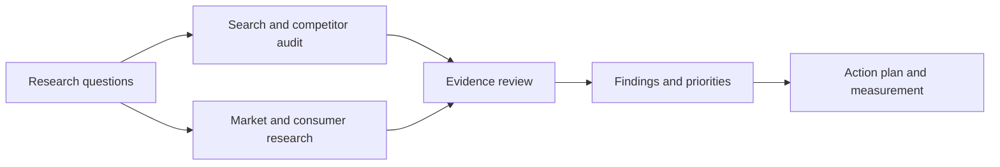

# Gousto: Digital Marketing & Market Intelligence

**A UK meal-kit research project connecting search visibility, website experience and customer acquisition questions.**

**Research by Ying-Hsuan (Joe) Fang · Market research: February–March 2026 · SEO audit: May 2026**

## Project overview

I investigated how Gousto attracted search demand, how its digital presence compared with competing brands, and where website or customer-experience signals suggested opportunities for improvement. The project combines a detailed SEMrush audit with desk research across advertising, consumer discussions and market sources.

The work produced a competitive benchmark, keyword opportunity shortlist, technical SEO and performance audit, evidence review, and prioritised action plan. Its purpose was to translate research into practical marketing decisions: **which audiences to investigate, which website issues to address first, and which commercial assumptions required stronger evidence.**

## Research period and scope

| Workstream | Historical period | Coverage |
|---|---|---|
| Market and consumer intelligence | February–March 2026; project log runs from 18 February to 17 March | Promotion messages, consumer discussions, competitor and market context, AI-assisted interpretation and source checking. Individual source capture dates were not consistently retained. |
| Domain overview | 7 May 2026 snapshot | Gousto, UK desktop search estimates. |
| Competitive search benchmark | 12 May 2026 snapshot | Gousto, HelloFresh, Mindful Chef and Prep Kitchen, UK desktop. |
| Technical and performance audit | Audit updated 12 May 2026 | 100-page mobile crawl with JavaScript rendering disabled; mobile Lighthouse-based performance sample of 10 URLs, of which 9 returned metrics. |

**These are historical findings, not a current audit.** The two research phases inform one project narrative but are not treated as a single contemporaneous dataset. Later editorial and analytical refinements are dated separately in the [revision log](validation/revision-log.md); no fresh Gousto data collection or implemented business results are implied.

## Tools and sources

| Tool or source | How I used it | Output |
|---|---|---|
| **SEMrush Domain Overview** | Reviewed search traffic estimates, authority, keyword coverage, backlinks and leading queries. | Domain baseline and search acquisition profile. |
| **SEMrush Compare Domains and keyword research** | Compared four brands, branded/non-branded traffic mix and candidate search terms using volume, difficulty and intent. | Competitor benchmark and five-keyword shortlist. |
| **SEMrush Site Audit** | Examined a 100-page crawl, issue categories, affected page/image instances and audit configuration. | Prioritised technical SEO remediation queue. |
| **SEMrush Lighthouse-based performance panel** | Compared LCP, TBT and CLS across sampled pages, including homepage, menu, pricing and discount journeys. | Page-level performance diagnosis priorities. |
| **Meta Ad Library** | Reviewed promotional messaging as part of acquisition research. | Questions about offer positioning and promotion dependency. |
| **Reddit and Trustpilot** | Reviewed consumer discussion and reported experience alongside brand-facing messages. | Qualitative themes and alternative explanations to investigate. |
| **Kantar and competitor/industry sources** | Added market and positioning context. | Pricing and value-proposition questions. |
| **Lens.org** | Investigated technology/patent signals and assessed their relevance. | An evidence check: patent material could not establish deployment or operational failure. |
| **Gemini** | Supported exploratory scanning/summarisation and language/terminology work; interpretations were checked against other sources. | A documented AI–human judgement example. |

The analysis uses vendor estimates, sampled technical observations and qualitative desk research. It does not claim a coded sentiment dataset or access to internal customer economics. [Source details](evidence/sources.md).

## Research method

1. **Frame the decisions.** Define the questions around discovery, website experience and acquisition quality, then identify the evidence each question requires.
2. **Establish the search baseline.** Record domain metrics and leading queries; keep the 7 May domain overview separate from the 12 May comparison.
3. **Benchmark competitors.** Compare reach and keyword coverage, then examine both the share and approximate scale of non-branded discovery. Translate differences into targeting choices rather than a simple ranking of brands.
4. **Assess keyword opportunities.** Review five candidates using reported search volume, keyword difficulty and commercial intent; add a product-fit check to distinguish cook-at-home recipe boxes from prepared-meal searches.
5. **Audit the website journey.** Categorise crawl issues and compare sampled page-performance results. Prioritise commercial touchpoints and verify causes before prescribing a fix.
6. **Triangulate market and consumer signals.** Compare promotional messages, public discussion and market context; record alternative explanations, source bias and what each source cannot establish.
7. **Translate evidence into recommendations.** Separate observation, inference and proposal; assign priorities, measures and conditions for expanding, adjusting or stopping a proposed action.

## 1. Search visibility and competitive position

The **7 May domain overview** reported an Authority Score of 52, 412.6K estimated organic traffic, 37.7K organic keywords, 123.6K backlinks and 4.5K referring domains. Leading reported queries included “gousto”, “gusto”, “gousto recipes”, “gousto meals” and “gousto login”. These suggested substantial brand-related discovery; mixed intent and the ambiguous “gusto” query require care when interpreting the list.

For like-for-like competitor analysis, I used the separate **12 May comparison**:

| Brand | Authority Score | Estimated organic traffic | Organic keywords | Non-branded share |
|---|---:|---:|---:|---:|
| Gousto | 52 | 409,600 | 37,700 | 16% |
| HelloFresh | 58 | 767,300 | 74,100 | 38% |
| Mindful Chef | 42 | 47,900 | 8,000 | 27% |
| Prep Kitchen | 44 | 60,700 | 6,500 | 40% |

**Finding:** Gousto had a smaller non-branded share than all three comparison brands, while HelloFresh had the largest estimated search footprint. However, applying the rounded shares gives approximately 65.5K non-branded traffic for Gousto, above Mindful Chef’s 12.9K and Prep Kitchen’s 24.3K. A lower share did not mean lower absolute discovery than every competitor.

**Implication:** prioritise relevant category searches rather than trying to replicate a competitor’s entire footprint. Investigate specific customer needs and product fit before investing in content. Search visibility alone does not show acquisition efficiency or loyalty. [Evidence E01–E02](evidence/evidence-register.csv).

## 2. Keyword opportunities

| Candidate keyword | Reported monthly volume | Reported KD | Recommended treatment |
|---|---:|---:|---|
| food boxes | 3,600 | 24 | Validate broad search intent and recipe-box relevance first. |
| food box delivery | 1,300 | 41 | Validate delivery intent and landing-page fit first. |
| meal prep services | 4,400 | 51 | Secondary candidate; users may expect prepared meals. |
| meal prep delivery | 2,900 | 60 | Defer until intent and content effort are understood. |
| meal prep companies | 1,300 | 59 | Assess comparison intent and competitive effort before prioritising. |

The five terms total **13,500 estimated monthly searches**, not distinct customers. The shortlist comes from the retained analysis; exact keyword exports were not recovered. Commercial intent and KD are screening inputs, not proof of conversion or achievable rankings. [Keyword data](evidence/keyword-candidates.csv).

## 3. Technical SEO and website performance

The 100-page audit reported **73% Site Health, 28 error instances and 1,156 warning instances**. I reviewed the underlying issues rather than using the score as the sole priority measure:

| Issue | Recorded count | Proposed response |
|---|---:|---|
| Duplicate content | 4 pages | Review URL purpose and indexation before canonicalisation or redirects. |
| Duplicate titles | 8 issues | Create descriptive titles after confirming page differences. |
| Duplicate meta descriptions | 10 pages | Improve page-specific summaries and evaluate CTR in context. |
| Broken internal images | 6 issues | Verify and repair affected assets, prioritising key journeys. |
| Missing alt attributes | 460 image instances | Review image purpose and provide appropriate text alternatives. |

Performance results further distinguished the pages that warranted investigation:

| Page | LCP | TBT | CLS |
|---|---:|---:|---:|
| Homepage | 20.72s | 1,616ms | 0.000 |
| Menu and plans | 19.97s | 981ms | 0.000 |
| Box prices | 13.36s | 1,288ms | 0.001 |
| Student discount | 8.10s | 1,306ms | 0.030 |
| Cookie policy | 2.25s | 34ms | 0.000 |

**Finding:** the historical lab results indicated loading and main-thread responsiveness concerns on important commercial pages, while measured layout stability was good.

**Implication:** reproduce and diagnose homepage, pricing and menu issues before broad acquisition expansion. These are lab observations; they do not quantify lost sales or prove a specific technical cause. TBT remains a lab diagnostic, with field INP assessed separately where available. [Full audit and interpretation](case-study/digital-marketing-audit.md).

## 4. Market intelligence and AI-assisted research

My desk research examined three connected questions:

| Research question | Evidence considered | Conclusion supported by the review |
|---|---|---|
| Does promotional activity indicate acquisition dependency? | Advertising messages, Reddit discussion and an AI-assisted loyalty interpretation. | Promotion sensitivity is a hypothesis; cohort retention and contribution data are needed to assess profitability. |
| What does competitor positioning mean for Gousto’s value proposition? | Competitor signals, market context and differences in search audiences. | Test segment-specific value and product fit rather than infer Gousto’s price elasticity from competitors or aggregate conditions. |
| Do customer-experience signals establish an operational cause? | Public reviews and technology/patent material. | Investigate reported friction; reviews and patents alone do not establish incident prevalence, deployment or causation. |

One documented example compares Gemini’s optimistic loyalty interpretation with promotional and discussion evidence. My initial challenge identified another explanation, but also went too far in asserting zero-LTV customers. The revised conclusion retains the question and removes the unsupported certainty. This demonstrates **checking both AI output and the human response against the evidence**. [AI–human review](methodology/ai-human-review.md).

## Recommendations and measurement

| Priority | Proposed action | Measure of progress |
|---|---|---|
| 1. Establish reliable baselines | Refresh comparable search/crawl data before any implementation; define query and customer cohorts. | Consistent date, device, market, eligibility and denominator definitions. |
| 2. Address verified journey issues | Diagnose performance bottlenecks and fix confirmed image, metadata and URL issues. | Comparable lab/field readings, verified issue resolution and funnel/accessibility guardrails. |
| 3. Pilot relevant non-brand content | Validate intent, then test a focused food-box content/landing-page cluster. | Absolute qualified non-brand traffic and subscription signals alongside traffic share. |
| 4. Investigate acquisition and experience | Obtain cohort contribution, retention and verified incident data before broad commercial changes. | Cohort economics, repeat ordering and incident rates with appropriate denominators. |

The [60-day plan](recommendations/action-plan.md) specifies functional owners, dependencies and review gates. It is a proposal: no implementation, revenue uplift or retention improvement is claimed.

## Deliverables and capabilities

| Deliverable | Capability demonstrated |
|---|---|
| [Digital marketing audit](case-study/digital-marketing-audit.md) | SEMrush interpretation, competitor benchmarking, keyword evaluation and technical prioritisation. |
| [Market intelligence review](case-study/market-intelligence-review.md) | Multi-source research, alternative explanations and decision-making under uncertainty. |
| [14-record evidence register](evidence/evidence-register.csv) | Source traceability and calibrated conclusions. |
| [AI–human review](methodology/ai-human-review.md) | Critical evaluation of AI-assisted interpretations and reflective judgement. |
| [Action and measurement plan](recommendations/action-plan.md) | Translating findings into prioritised work, metrics and validation. |

**Scope:** this portfolio presents my research, analysis and writing. Historical vendor estimates and qualitative sources are subject to their sampling and coverage limits; no internal customer or operational dataset was available. Detailed provenance and later changes are recorded in the [methodology](methodology/scope.md), [source register](evidence/sources.md) and [revision log](validation/revision-log.md).
