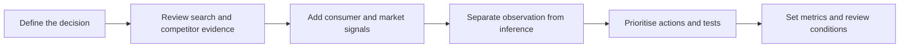

# Gousto: Digital Marketing & Market Intelligence

**Connecting search performance, consumer signals and evidence-based decisions.**

By Ying-Hsuan (Joe) Fang · UK meal-kit case study · Portfolio revision: 6 November 2026

## The business question

Where should Gousto focus its next round of investigation and improvement: reaching new search audiences, improving the website journey, or understanding promotion and customer-experience risks?

I combined an individual digital marketing audit with my research and writing contributions to a market intelligence group project. The case demonstrates competitive analysis, technical SEO interpretation, multi-source research and critical evaluation of AI-assisted findings.

**The central finding:** the historical search evidence supports investigating non-branded discovery and website performance. Public advertising and consumer discussions raise useful questions about acquisition and experience, but cannot establish customer lifetime value, churn or company-wide operational failure.

## Three findings and their implications

| Finding | Evidence | Decision implication |
|---|---|---|
| Gousto had substantial search visibility, with a smaller non-branded share than the three comparison brands. | May 2026 SEMrush comparison: 409.6K estimated organic traffic; 16% non-branded share versus 27–40% for comparison brands. [E01–E02](evidence/evidence-register.csv) | Test category searches that fit a cook-at-home recipe box; assess qualified visits and subscription outcomes rather than traffic share alone. |
| Important website journeys warranted performance investigation. | Historical mobile lab results: homepage LCP 20.72s and TBT 1,616ms; pricing-page LCP 13.36s. The crawl covered 100 pages. [E04–E06](evidence/evidence-register.csv) | Reproduce the issue, diagnose the bottleneck and prioritise affected commercial pages before scaling acquisition. These are lab observations, not measured lost sales. |
| Positive digital signals do not resolve questions about retention or customer experience. | My original intelligence work compared AI-assisted interpretations with advertising and consumer-discussion sources. The retained report supports an account of that process, but lacks a complete item-level source archive. [E07–E10](evidence/evidence-register.csv) | Treat promotion dependency and experience concerns as hypotheses; obtain cohort and incident data before making broad commercial decisions. |

## How the analysis works

The two coursework studies were conducted separately. Their findings are brought together here as a retrospective portfolio synthesis, not a single contemporaneous dataset.

## Explore the case

1. **[Digital marketing audit](case-study/digital-marketing-audit.md)** — competitor implications, keyword selection and technical priorities.
2. **[Market intelligence review](case-study/market-intelligence-review.md)** — signal quality, conflicting interpretations and decision limits.
3. **[AI and human judgement](methodology/ai-human-review.md)** — one documented individual example, including what the original human interpretation also overstated.
4. **[60-day action and measurement plan](recommendations/action-plan.md)** — owners, dependencies, metrics and decision gates.
5. **[Evidence register](evidence/evidence-register.csv)** and **[source notes](evidence/sources.md)** — provenance, confidence and missing evidence.
6. **[Revision log](validation/revision-log.md)** — how assessment feedback and source checks changed this version.

## My contribution

The digital audit comes from my individual MSIN0305 assignment. For MSIN0308, this portfolio draws on my intelligence sourcing, my individual AI reflection, and the framing and integration sections I wrote that were recorded under joint ownership. It does not reproduce the group submission or claim other members' individually attributed work.

The integrated recommendations and measurement framework are a **new portfolio extension dated 6 November 2026**. They have not been implemented or evaluated by Gousto. This is an independent academic portfolio, not commissioned client work.

## Evidence boundaries

Search figures are historical third-party estimates. Technical results are sampled lab/crawl observations. No internal transactions, retention cohorts, acquisition costs or fulfilment logs were available. Original coursework and personal identifiers are excluded. Revised conclusions distinguish retained observations, interpretation and proposed validation; no business uplift is claimed.

See [methodology and attribution](methodology/scope.md) for collection dates, contribution boundaries and AI disclosure.
